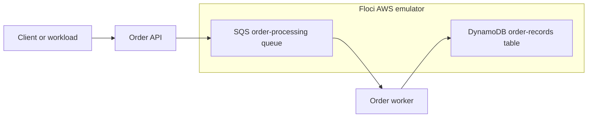
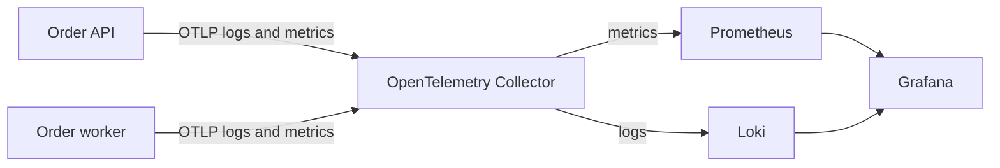
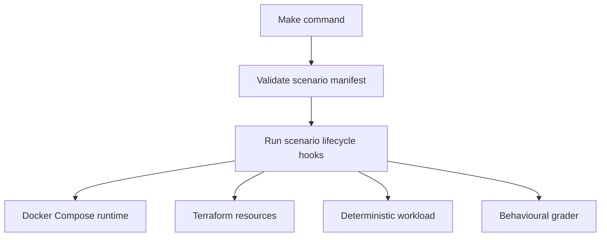

# Architecture

OutageGym separates the application being investigated from the platform that
creates, observes, resets, and grades an incident.

## Application path

The API accepts an order and publishes it to SQS. The worker consumes the
message, applies idempotent processing, and stores order and fulfilment records
in DynamoDB. Incident faults alter this otherwise healthy path.

## Observability path

Grafana is the main learner interface. Its provisioned dashboard combines
Prometheus metrics and Loki logs, including correlation IDs shared by the API
and worker. Prometheus also evaluates symptom-based alert rules.

## Scenario lifecycle

Each scenario owns a manifest, learner brief, fault configuration, lifecycle
hooks, workload, grader expectations, and optional learner workspace files.
Platform code invokes those interfaces without embedding scenario-specific
fault logic.

## Runtime responsibilities

| Component | Responsibility |
|---|---|
| Docker Compose | Runs and networks all local services |
| Floci | Emulates SQS and DynamoDB |
| Terraform | Creates scenario infrastructure in Floci |
| Order API and worker | Provide the system under investigation |
| OpenTelemetry Collector | Receives and routes application telemetry |
| Prometheus | Stores metrics and evaluates alerts |
| Loki | Stores searchable logs |
| Grafana | Presents dashboards and investigation views |
| k6 | Produces repeatable workload traffic |
| Grader | Verifies repaired behaviour from observable outcomes |

## Isolation and safety

- Compose scopes containers, networks, and volumes under
  `outagegym-<incident>`.
- Infrastructure and application resource names include the selected incident
  ID.
- Host ports bind to `127.0.0.1` by default.
- AWS clients use the internal Floci endpoint and fixed fake credentials.
- No host AWS credential directory or container-runtime socket is mounted.
- Initial setup requires registry access; complete egress isolation is deferred
  until runtime dependencies are packaged.
- Scenario hooks are local programs and should only be run from trusted sources.
- `make reset` removes scenario state, restores the original learner files, and
  recreates the incident deterministically.

This is local process isolation, not a security boundary. Learners can inspect
repository source and grader code; the MVP uses an honour-system investigation
boundary.

## Key decisions

- Docker Compose keeps the first local incident portable and inexpensive.
- Floci provides the required AWS behaviour without an AWS account.
- A continuous TypeScript worker avoids Docker-socket-dependent Lambda
  execution while preserving queue-processing semantics.
- Tooling runs in pinned containers so learners need only Docker, Git, Make,
  and `curl`.
- Kubernetes, Lambda-specific incidents, hosted sessions, and remote grading
  remain deferred until the local learning workflow is proven.

These choices trade cloud fidelity and stronger isolation for a deterministic,
one-command local experience.
